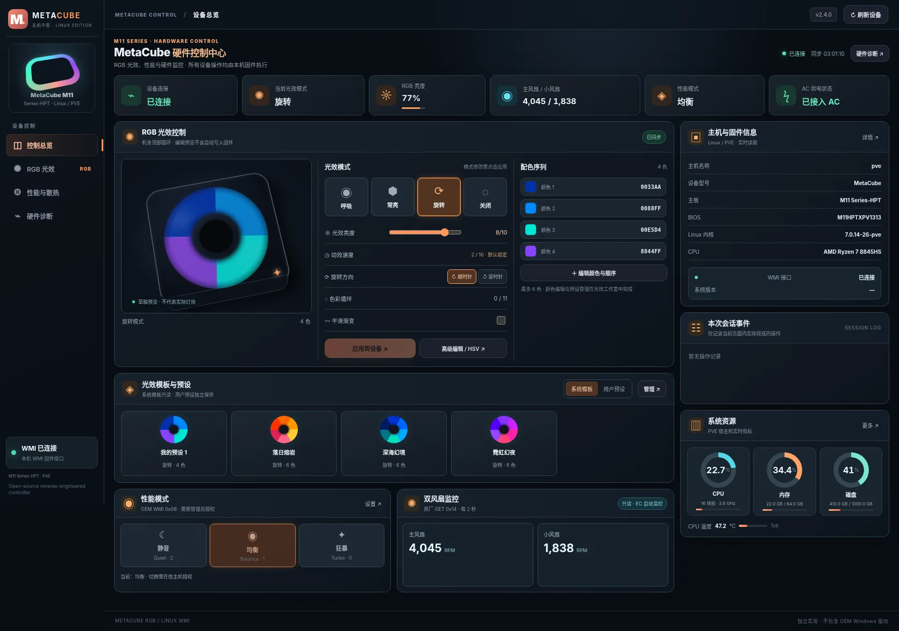
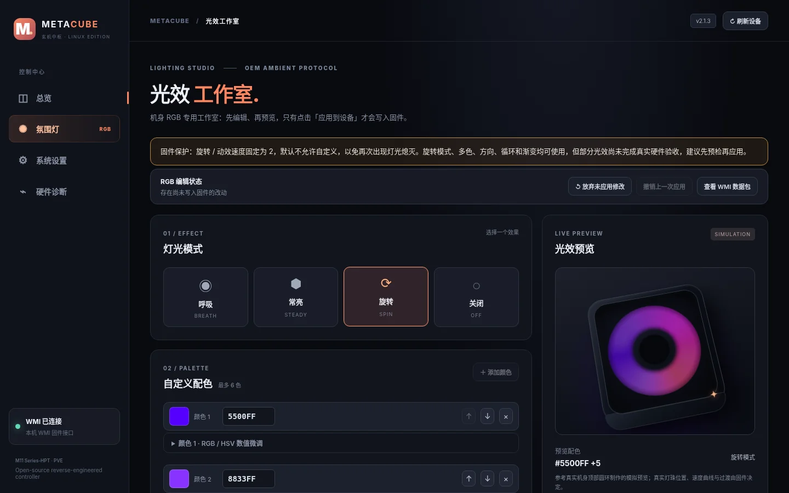
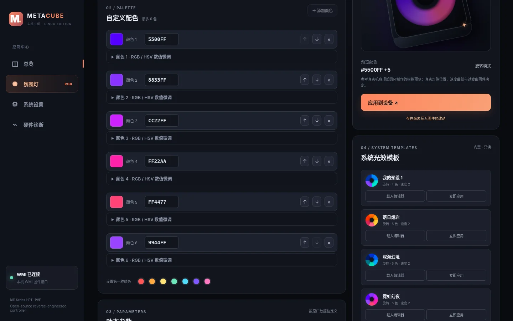
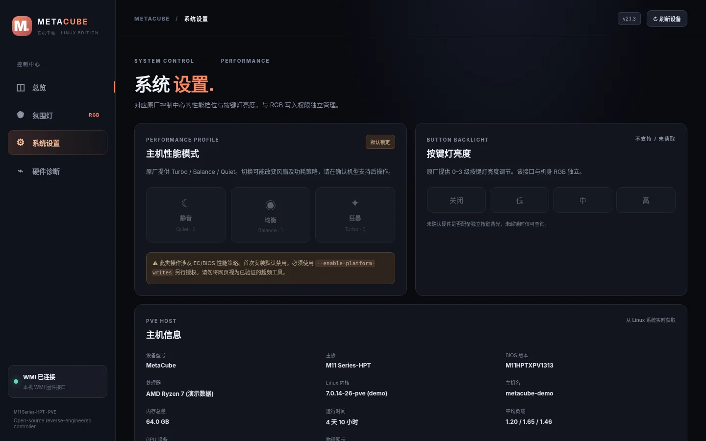

# MetaCube RGB Web v2.2.0 - OEM speed and fan readout parity

- **RGB speed:** original WPF slider is **0..10** (initial UI value 3, integer step 1), not 0..255. Linux preserves `speed=2` as the default firmware-write safety limit because of the earlier LED freeze.
- **Fan RPM:** the Windows performance page shows **Main Fan** and **Small Fan** RPM, polling once every **2 seconds** using a model-specific read-only **GET 0x14** (two big-endian RPM values). Linux v2.2 adds the same readout to System Settings and `metacube-rgb fans`; if unavailable, it clearly labels a fallback generic `GET 0x0d` reading.
- **No manual fan control:** the supplied original Windows performance UI does not expose a fan PWM slider. This Linux release also performs **zero fan writes**; generic Bitland `0x14/0x15` SET behavior is not assumed safe for this M11 firmware.
- **DKMS module is now 2.2.0** for the OEM fan reader; Web-only updating remains supported with a clearly labeled fallback. See [OEM speed/fan audit](docs/OEM_SPEED_FAN_AUDIT.md).

Existing PVE installation: back up current settings, then `git pull --ff-only` and `bash install.sh --enable-writes` for DKMS 2.2.0, or `bash install.sh --web-only` if you wish to keep the installed 2.1.0 kernel driver (only fallback fan readings available).

## v2.1.3 historical release — LED ring preview, system templates, speed-only guard

Web-only update; DKMS kernel module remains 2.1.0.

- Preview the actual top-cover ring geometry with conic RGB gradients and mode-specific animation. This is a browser approximation.
- Spin, up to six colors, direction, cycle, transitions, and brightness remain available by default. Only animation speed differs: firmware writes with speed other than **2** are rejected unless the administrator opts in with `METACUBE_ALLOW_SPEED_CUSTOMIZATION=1` (`METACUBE_EXPERIMENTAL_RGB=1` is supported for legacy deployments).
- Four bundled immutable system themes, copied verbatim from the user-supplied JSON, are separate from five persistent user-defined preset slots.
- `GET /api/templates`, `POST /api/templates/apply`, `metacube-rgb template list`, `metacube-rgb template apply ID`.
- No hardware WMI changes. Host-only files can be installed with `bash install.sh --web-only`.

## Earlier v2.1.x releases (historical notes)

Independent Linux/PVE WMI RGB control center for **METAPHYUNI MetaCube M11 Series-HPT**, based on static analysis of the user-supplied Windows `ControlCenter` (.NET `玄机中枢`) application. **Not the OEM Windows driver.**

## Screenshots / 界面截图

> Screenshots rendered from the v2.1.3 Web UI using **simulated device status and demo host metrics**. No physical RGB hardware was controlled to create these images.

### Dashboard · Device overview



### Lighting studio · Top-cover RGB ring preview



### Built-in themes, user presets and system information

| System templates & user presets | System settings & host details |
| :---: | :---: |
|  |  |

> The circular LED animation is a **browser simulation**, not a validated recording of the physical light controller. Custom effect speed remains locked to `2` by default.

- **RGB first:** 4 ambient modes, 1–6 editable colors, exact RGB/HSV numeric controls, 0–255 brightness, speed, spin direction, cycle value 0–11, gradient transition, color ordering and mode-specific simulated previews.
- **Web:** `metacube-rgb web`, Bearer-token authentication, LAN access enabled by default (limit firewall exposure); WMI request preview, one-step undo and stale-state write protection.
- **Presets:** 5 local lighting presets, save/preview/apply separately, import/export validated JSON. OEM `.dat` files are **not compatible**.
- **Driver:** one WMI `0x0F` SET per complete RGB profile, GET readback validation, DKMS, existing MOK signing; no PVE kernel image/boot modifications.
- **Other OEM features:** Linux host metrics and explicit diagnostics; unsafe thermal/fan/GPU controls intentionally not writable by default.

**LED output incident (2026-11-04):** The owner observed RGB LEDs stop emitting light after changing rotation-effect speed, even though firmware GET returned valid updated settings. A complete power-down, unplugging AC, and restarting restored the previously saved blue breathing effect. The direct cause is unconfirmed. **Advanced RGB writes are therefore disabled by default in v2.1.2.** Only one-color `breath`, `steady`, `off`, and brightness/one-color changes with `speed=2 direction=0 cycle=0 transition=0` are allowed. Web shows an explicit warning and disables advanced effect controls. Local operators may intentionally opt in via `METACUBE_EXPERIMENTAL_RGB=1`, but this may require another cold power-cycle. OEM keyboard RGB WMI probes that produced `AE_NOT_FOUND` are also skipped by default. This protection is in Python/Web/CLI, not in the kernel driver; direct root sysfs writes remain possible.

## Install / Upgrade on PVE

Read the **[Chinese documentation](README.zh-CN.md)** and **[RGB hardware acceptance plan](docs/RGB_HARDWARE_TEST.md)** before enabling advanced effects.

```bash
apt update
apt install -y git dkms build-essential python3 mokutil proxmox-default-headers "proxmox-headers-$(uname -r)"
git clone https://github.com/heroixinu/metacube-rgb.git
cd metacube-rgb
bash install.sh --enable-writes
metacube-rgb web
```

If already cloned, use `git pull --ff-only` instead of cloning again. Web now listens on `0.0.0.0:8765`, prints detected reachable LAN URLs, and displays the Bearer token in an **interactive terminal**. Systemd output does not include credentials. To expose only your management address: `metacube-rgb web --host <PVE-LAN-IP>`. HTTP has **no transport encryption**: restrict TCP 8765 to trusted clients or use an HTTPS reverse proxy.

### Update only the Web application (existing 2.1.0 DKMS installations)

Stop an existing foreground `metacube-rgb web` with Ctrl+C, then:

```bash
cd /root/metacube-rgb
git pull --ff-only
bash install.sh --web-only
metacube-rgb web
```

The `--web-only` path does not uninstall, reload, rebuild or re-sign the kernel module. It updates Python/Web files and restarts the optional systemd Web service if it was already running. If `/etc/default/metacube-rgb-web` explicitly sets `METACUBE_WEB_HOST=127.0.0.1`, that override still takes priority; change it to `0.0.0.0` or your management IP first. To force displaying the token when stdout is redirected, use `--show-token` (the token may be saved in logs). Do not expose port 8765 to the internet.

```bash
# Creates a 32-byte SET preview but NEVER writes hardware:
metacube-rgb set --mode spin --colors FF0000 00FF00 --brightness 160 --speed 2 --direction 0 --cycle 6 --transition 1 --dry-run
# v2.1.2 deliberately BLOCKS the advanced write unless the host operator explicitly opts in.
# The dry-run preview never writes firmware.
```

**Hardware status:** Single-color, brightness, breathing and steady modes were physically verified. An advanced-effect speed operation was followed by loss of visible light until the machine was completely powered down and AC removed. Multi-color/spin/speed/cycle/transition behaviors are **not safely verified**. Reading firmware settings back does not prove physical LED timing or direction. The web's animation is illustrative only. Don't run experimental firmware writes while important VMs are active.

Project scope: [OEM capability matrix](docs/OEM_FEATURE_MATRIX.md) · [RGB validation](docs/RGB_HARDWARE_TEST.md) · [Changelog](CHANGELOG.md).

## License

Kernel driver: GPL-2.0-only; Python/Web components: MIT (see LICENSE). No proprietary OEM Windows binaries, firmware, images or third-party fonts are redistributed.
