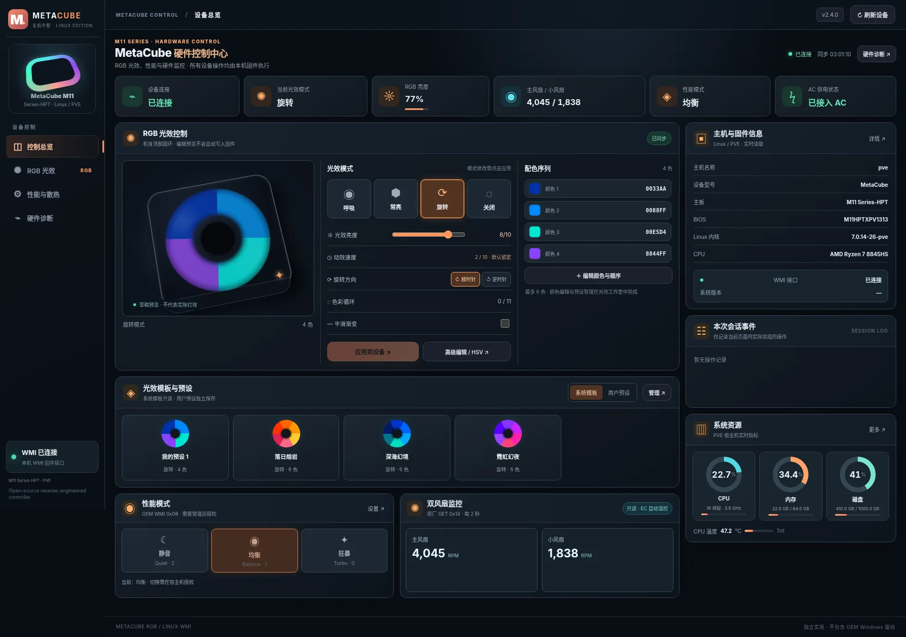
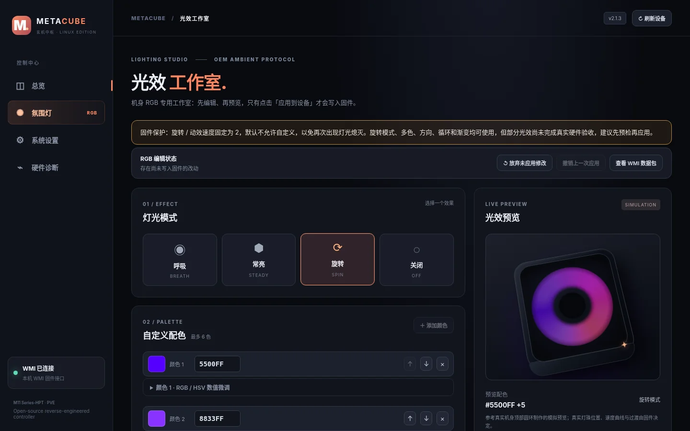
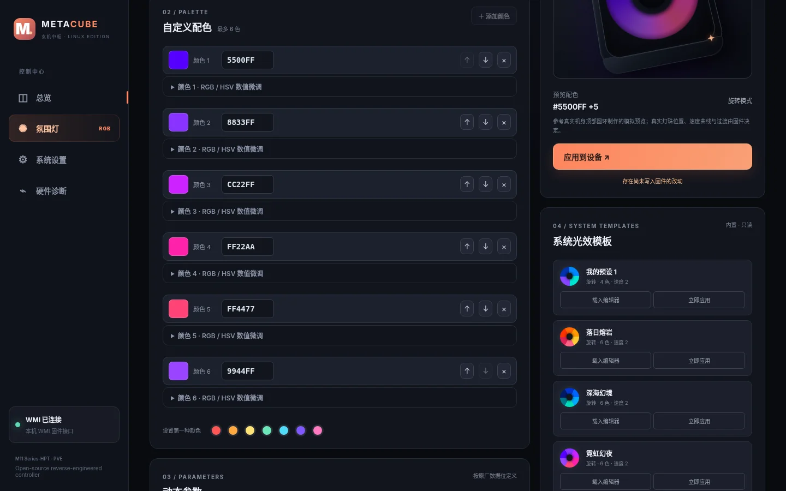
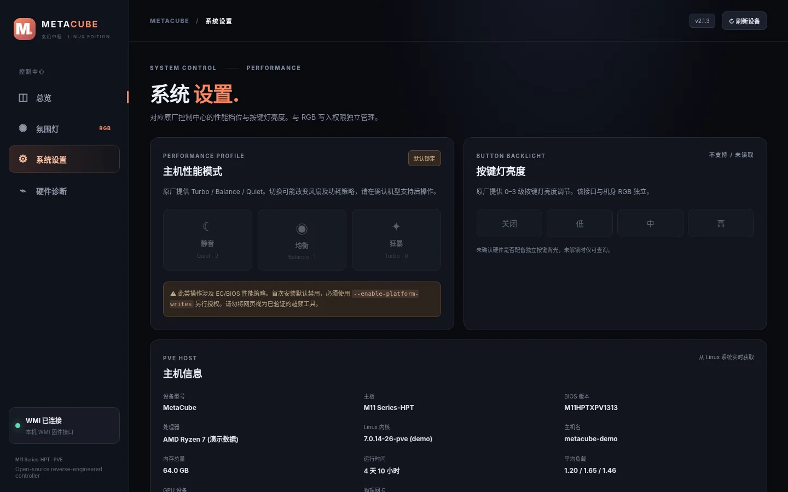

# MetaCube RGB Web v2.2.0：还原原厂速度档位和风扇转速显示

**本版变化：** 原厂 `SpinSpeedSlider` 速度范围为 0–10、整数步进、界面设计初始值 3；本机已验证安全值为 2，因此仍默认锁定速度 2。原厂性能页面显示「主风扇 / 小风扇」转速，每 2 秒只读刷新；新版内核驱动新增 GET 0x14（高字节在前）读取，失败时显示标记后的通用 GET 0x0D 回退值。

**原厂程序未在此页面提供用户手动控制风扇 PWM 的滑块；本项目也不会增加未经验证的风扇写入操作。** 详细协议核查见 [原厂速度与风扇研究](docs/OEM_SPEED_FAN_AUDIT.md)。

## v2.2.0 更新摘要

- OEM Windows `SpinSpeedSlider`: `Minimum=0`, `Maximum=10`, default WPF UI value `3`, integer `SmallChange=1`. The original slider updates a draft packet; an explicit Apply submits the WMI SET. The Linux Web slider now matches 0..10, but stays locked to known-safe speed `2` unless the host administrator explicitly opts in.
- OEM Windows performance page polls **Main Fan / Small Fan** RPM every **2 seconds**. The original executable queries `GET 0x14` and decodes each RPM using big-endian bytes. A new read-only 2.2.0 DKMS attribute plus `metacube-rgb fans` and the System Settings page reproduce this monitoring path. If unsupported, Linux falls back to generic `GET 0x0d` and states the data source explicitly.
- The owner-supplied Windows program does **not** expose a manual fan PWM speed slider in its performance page. No Linux fan control SET was added: this would risk cooling a running PVE host and cannot be justified from the original UI.
- The four system themes and five user preset slots remain separate. Legacy stored speeds above 10 are shown as safe speed 2 without rewriting the original file on read.
- Full audit: [OEM_SPEED_FAN_AUDIT.md](docs/OEM_SPEED_FAN_AUDIT.md).

## Update commands

```bash
cd /root/metacube-rgb
git pull --ff-only
# Web-only: retain existing DKMS 2.1.0; generic fan fallback only
bash install.sh --web-only
metacube-rgb fans
# To enable the OEM GET 0x14 reader later, use a maintenance window:
# bash install.sh --enable-writes
```

> **v2.1.3 本次更新：** 预览采用机身顶部发光圆环模型，支持呼吸/常亮/旋转/熄灭和多色分布。取消旋转、多色及方向等默认锁定；**仅自定义旋转/动效速度默认锁定为 2**。支持读取内置 4 套系统模板，和 5 个用户自定义槽位完全独立。系统模板直接来自你提供的 `metacube-rgb-presets-4-themes(1).json`，包括第一组原名“我的预设 1”。内置模板不能编辑或删除，但可以加载到编辑器或应用，也不会覆盖用户预设。

## v2.1.3 历史版本说明（圆环预览、系统模板、仅速度保护）

这是针对 **METAPHYUNI MetaCube / M11 Series-HPT** 的 Linux 原生 WMI 控制中心。基于你提供的 Windows「玄机中枢」ControlCenter 安装包，独立实现原厂可见的机身 RGB 编辑界面、系统设置和监控能力。

> **重要：这是 v2.1 的软件功能完善版，新增高级 RGB 光效仍未通过实机验收。** 你实际验证成功的是 v1.0 的单色、亮度与模式。v2 新增的多色、速度、方向、循环、渐变以及性能/按键灯控制已经按原厂程序的指令结构实现，但尚未在你的机器上验证实际效果。首次请在维护窗口测试；不要直接在承载关键虚拟机业务时测试新固件指令。

## Web 控制台截图

> 以下图片由 **v2.1.3 网页实际渲染**，使用模拟灯光状态与演示主机指标生成；不是从你的 PVE 采集的真实监控画面，也没有向固件发送控制指令。

### 设备总览



### RGB 光效工作室 · 圆环预览



### 系统光效模板、用户预设与设备信息

| 系统模板及用户自定义预设 | 系统设置与主机信息 |
| :---: | :---: |
|  |  |

> 圆环运动和渐变均为**浏览器模拟预览**，不代表真实硬件一定具有同样的速度和过渡效果。旋转速度自定义仍默认锁定在 `2`。

## 包含哪些功能

- `metacube-rgb web` 启动本地加密令牌认证的 Web 控制台，全部 HTML/CSS/JS 随源码提供，无需前端安装依赖。
- 机身氛围灯：呼吸 / 常亮 / 旋转 / 关闭；1–6 色 RGB；亮度 0–255；旋转速度 0–10（默认仅允许速度 2）、方向；0–11 级颜色循环；渐变开关。支持**点击「应用到设备」后一次性写入**和 WMI 回读校验。
- 五个可保存/恢复的本地灯光预设，取代原 Windows 软件的 `.dat` 保存方式（无法直接导入 Windows 的二进制预设）。
- 系统：静音 / 均衡 / Turbo 档位、按键灯 0–3 级；这两种写入**默认锁定**，需显式 `--enable-platform-writes` 才能开启；Turbo 额外要求固件确认圆口适配器。
- 主机监控：Linux CPU 使用率 / 频率 / 负载、内存、磁盘、硬件温度与风扇；系统信息显示实际 PVE 主机而非虚拟机。
- WMI 能力检测：GPU 模式、Fn Lock、触摸板、RGB 键盘和其他原厂函数的**按需只读**查询。未验证的 GPU 切换、风扇强制转速、CPU 功耗等危险操作不开放。
- DKMS 自动编译 + 你已经注册的 MOK 证书签名 + 可选的 systemd 开机恢复。

完整对照：[原厂功能矩阵](docs/OEM_FEATURE_MATRIX.md)；逐项验收：[RGB 实机测试清单](docs/RGB_HARDWARE_TEST.md)。

## 安装 / 升级（兼容已装 v1.0 / v2.0 DKMS 用户）

1. 先备份当前灯光设置：

```bash
metacube-rgb status --json > /root/metacube-rgb-backup.json
cp /etc/metacube-rgb.conf /root/metacube-rgb.conf.bak 2>/dev/null || true
```

2. 直接从 GitHub 拉取并安装：

```bash
apt update
apt install -y git dkms build-essential python3 mokutil proxmox-default-headers "proxmox-headers-$(uname -r)"
cd /root
git clone https://github.com/heroixinu/metacube-rgb.git
cd metacube-rgb
bash install.sh --enable-writes
```

**安装程序不会主动修改灯光或 PVE 引导配置。** 它先构建 v2.2 DKMS，确认编译后再替换现有的 v1.0 / v2.0 模块。成功时卸载旧 DKMS 版本的注册，避免未来两个版本同时构建；保留 `/usr/src/metacube-ambient-1.0.0` 作为旧版源码备份。不会删除 MOK 私钥或公钥。

如果只是维护当前 RGB 功能，**不要**在首次安装时加 `--enable-platform-writes`。若此前 v1 已设 `allow_writes=1`，省略参数会尝试继承现有权限；为明确起见仍建议显式提供 `--enable-writes`。

## 直接通过 PVE 内网 IP 访问 Web

```bash
metacube-rgb web
```

默认监听所有 IPv4 接口 `0.0.0.0:8765`。启动信息会尽量列出主机检测到的**实际内网地址**，例如 `http://192.168.18.99:8765`（请以你机器输出为准）。

在**交互式终端**中，启动时会直接输出完整的 `Bearer token`，复制到浏览器登录页面即可。后台 systemd 服务不会将令牌写入 journal；已生成的令牌会复用，位置仍为 `/etc/metacube-rgb/web.token`。如果使用无 TTY 的重定向命令、明确需要输出令牌，可以加 `--show-token`，但该选项可能使 Token 进入日志。

如只希望服务监听指定的 PVE 管理 IP（减少其他网段访问），执行：

```bash
metacube-rgb web --host 192.168.18.99 --port 8765
```

上面的 IP 仅为示例，请换成你的实际管理地址。若要继续使用 SSH 隧道，仍可 `metacube-rgb web --host 127.0.0.1`。

**安全提醒：** HTTP 没有 TLS 加密，即使使用 Bearer Token，局域网中的明文请求仍有泄露风险。务必通过 PVE 防火墙、网络 ACL 限制 TCP 8765 的来源地址；不要做公网端口映射。需要跨不可信网络访问时请使用 HTTPS 反向代理或 VPN。

### 已安装 v2.1.x：仅升级 Web，无需重新构建驱动

如果之前通过终端运行了 Web，请先按 `Ctrl+C` 停止它，然后执行：

```bash
cd /root/metacube-rgb
git pull --ff-only
bash install.sh --web-only
metacube-rgb web
```

`--web-only` 仅更新 CLI、Python Web 服务与静态网页；**不会卸载、重载、重编译或重新签名 DKMS 内核模块**。已启动的 systemd Web 服务会在更新过程中自动重启。

如果 `/etc/default/metacube-rgb-web` 已有自定义 `METACUBE_WEB_HOST=127.0.0.1`，它依然优先于默认值，需手工修改或删除覆盖项。

## 开机自动启动 Web（可选）

默认不启用 systemd Web 服务。可执行：

```bash
systemctl enable --now metacube-rgb-web.service
systemctl status metacube-rgb-web.service
```

默认也监听 `0.0.0.0:8765`，但 systemd 日志**不显示令牌**。如需仅绑定指定接口：

```bash
cat > /etc/default/metacube-rgb-web <<'EOF'
METACUBE_WEB_HOST=192.168.18.99
METACUBE_WEB_PORT=8765
EOF
systemctl restart metacube-rgb-web.service
```

停用服务：`systemctl disable --now metacube-rgb-web.service`。

**安全设计说明**：Web 服务需要写入 root 所有的 WMI sysfs 文件，因此以 root 启动，并采用 Bearer Token、同源校验和请求白名单。由于默认允许内网访问，务必使用防火墙限制可信来源；内网 HTTP 本身不加密。

## CLI（保留 v1 命令）

```bash
metacube-rgb status
metacube-rgb mode breath
metacube-rgb color FF0000
metacube-rgb brightness 160

# 完整 RGB 参数设置
metacube-rgb colors FF0000 00FF00 0000FF
metacube-rgb mode spin
metacube-rgb speed 2  # 默认安全速度；其他速度需主动解锁
metacube-rgb direction 1
metacube-rgb cycle 6
metacube-rgb transition 1

# 先预检完整 32 字节 SET 数据包：不写入固件
metacube-rgb set --mode spin --colors FF0000 00FF00 0000FF \
  --brightness 160 --speed 2 --direction 0 --cycle 6 --transition 1 --dry-run

# 一次 SET 更新完整 RGB 配置（维护窗口才执行）
metacube-rgb set --mode spin --colors FF0000 00FF00 0000FF \
  --brightness 160 --speed 2 --direction 0 --cycle 6 --transition 1

# 5 组本地预设
metacube-rgb preset save 1 --name '银河'
metacube-rgb preset list
metacube-rgb preset apply 1
metacube-rgb preset delete 1
metacube-rgb preset export --file /root/metacube-presets.json
metacube-rgb preset import --file /root/metacube-presets.json

# 系统与 OEM 诊断
metacube-rgb system
metacube-rgb oem
```

切换**性能模式或按键灯**需显式二次授权，然后重新运行安装脚本使模块参数在下次启动仍生效：

```bash
cd /root/metacube-rgb
bash install.sh --enable-writes --enable-platform-writes
metacube-rgb platform system_mode balanced
metacube-rgb platform button_brightness 2
```

这个写入能力未在你的主机上验证，请慎用；Turbo 仅在主板 WMI 读取到圆孔适配器类型时才允许。

## 开机恢复灯光（可选）

```bash
metacube-rgb save
metacube-rgb apply --dry-run
systemctl enable --now metacube-rgb-restore.service
```

旧版 `/etc/metacube-rgb.conf` 的单色模式继续兼容。若主板能自行持久保存配置，不需要启动服务。

## DKMS 验证与回滚

```bash
uname -r
dkms status -m metacube-ambient
modinfo -F version metacube_ambient
modinfo -F signer metacube_ambient
metacube-rgb status
```

应显示 `metacube-ambient/2.2.0` 已安装、签名者仍为 `DKMS module signing key`。未来更新 PVE 内核时需要新内核 Headers，否则 DKMS 不能成功构建。升级前请通过 `dkms status` 验证新内核条目。

卸载：

```bash
cd /root/metacube-rgb
bash uninstall.sh
```

默认保留 Web token、5 组预设和开机灯光配置；加 `--purge-user-data` 才清除这些文件。卸载不触碰 MOK 密钥、PVE 引导项或 EFI 配置。旧版源代码位于 `/usr/src/metacube-ambient-1.0.0`，可根据旧版安装包重新安装 v1.0。

## 运行测试

```bash
cd /root/metacube-rgb
PYTHONPATH=. python3 -m unittest discover -s tests -v
bash -n install.sh && bash -n uninstall.sh
# 可选：需要本地 Chromium + Python Playwright；通过浏览器内 mock API 测试，不访问真实硬件
python3 tests/test_browser_rgb.py
```

测试会使用模拟设备，不触发任何真实 WMI 调用。`tests/visual_check.py` 是需要 Chromium/Playwright 环境的可选 UI 视觉检查，不会在 PVE 上自动运行。

## v2.1 RGB 专项增强说明

- 在 Web「光效工作室」中，最多可以编辑 6 种颜色，分别支持原厂式 RGB 三通道（0–255）和 HSV 数值（H 0–360，S/V 0–100），也能调整颜色顺序。
- 全部效果参数（呼吸、常亮、旋转、关闭、亮度、速度、方向、循环、渐变）先在浏览器草稿中编辑，预览动画不等同于固件真实灯带运动。
- 5 个预设支持**保存草稿、载入到编辑器、直接应用**三种不同操作；保存、导入、载入均不修改主板，只有点击「应用到设备」或「立即应用」才发送 WMI SET。
- 编辑前保存固件的 32 字节状态；如果其他操作修改过配置，Web 拒绝覆盖并要求刷新。可以查看即将发送的 WMI 数据包（仅预检），并撤销当前 Web 会话内上一次成功应用的灯光。
- Web 预设支持 JSON 导入/导出。原 Windows 软件的 `.dat` 格式未进行兼容性确认，**不可直接导入**。
- 软件上的 RGB 编辑与通信字段已覆盖原厂机身氛围灯，但**高级效果仍需要逐项实机验证**。相关测试步骤与恢复命令见 [RGB 实机验收文档](docs/RGB_HARDWARE_TEST.md)。

## 尚未覆盖或刻意不开放的原厂功能

原厂 Windows 程序的系统信息、性能档位与按键灯已由 v2 提供只读或显式解锁的功能；RGB 键盘 `0x10–0x12` 仅做只读能力检测，并未确认这台 MetaCube M11 实际存在对应硬件。GPU 模式切换、风扇强制转速和 CPU 功耗写入不属于本次 RGB 专项范围，不应在 PVE 宿主机上未经验证就开放。

## v2.1.2：高级 RGB 灯光故障后的保护模式

MetaCube M11 在修改旋转动效速度后出现了**固件仍可回读，但实体 LED 不再发光**的情况；完整关机并拔掉交流电源后恢复正常。故障原因尚未确定，不能把 WMI GET 成功等同于 LED 实际亮起。

本版本只更改 Python/Web/CLI，不重新编译或加载内核模块。为避免误操作：

- 默认放行已经验证的**单色呼吸、单色常亮、关闭以及亮度/单色更改**，安全基线为 `speed=2 direction=0 cycle=0 transition=0`。
- 默认拒绝所有未验证的**旋转、多色、速度、方向、循环和渐变**固件写入（CLI、Web、预设应用和开机恢复共用守卫）。
- Web 会灰掉相应编辑器按钮，显示醒目提示；WMI 数据包预览仍可使用，但明确标注是否允许写入。
- 对可触发 `AE_NOT_FOUND` 的 OEM 键盘 RGB 只读探测，默认不再发送对应 WMI 请求。
- 若你准备在维护窗口继续实验，必须由 PVE 本地管理员在服务启动前显式设置 `METACUBE_EXPERIMENTAL_RGB=1`；Web 请求中的参数无法解除保护。启用后仍存在实体灯带熄灭、需要完整断电恢复的风险。
- 如果必须研究不支持的 OEM RGB 键盘 WMI 只读函数，需要另行设置 `METACUBE_EXPERIMENTAL_OEM_READS=1`，这并不表示该硬件存在或可安全调用。

**仅更新应用层（无需 DKMS 编译、签名或 PVE 重启）：**

```bash
cd /root/metacube-rgb
git pull --ff-only
bash install.sh --web-only
metacube-rgb status
```

手动运行的旧版 `metacube-rgb web` 需要先 `Ctrl+C` 退出，再重新启动；通过 systemd 运行的 Web 服务会由安装器在更新中安全重启。

> 保护仅覆盖本项目的 CLI / Web / 预设 / 开机恢复操作。拥有 root 权限的程序仍可绕过应用层，直接写入内核模块的 sysfs 文件。本版未更改驱动级写入能力。

## v2.1.3 光效预览与速度保护

- `metacube-rgb web` 的设备预览现在模拟顶部 RGB **圆环**。常亮固定，呼吸明暗变化，旋转绕圆心运动，关闭时熄灭；多色沿圆环分布，渐变开关控制柔和过渡/硬分段。动画是浏览器模拟，不能证明真实灯带的运动路径与速度。
- 旋转模式、多色、方向、循环、过渡默认可写。之前只在改变速度后出现 LED 不亮，断电恢复；新版本默认禁止写入 **speed != 2**。只有本机管理员显式 `METACUBE_ALLOW_SPEED_CUSTOMIZATION=1` 才能解锁（旧环境变量 `METACUBE_EXPERIMENTAL_RGB=1` 继续兼容）。**不建议实际解除该保护**。
- Web 编辑器的速度滑块默认禁用，并以 `2` 为基准；如果当前固件速度不是 2，编辑器会将 `2` 暂存为待应用草稿，不会自动写入硬件。
- `metacube_rgb/system_templates.json` 内置 4 套只读模板；`GET /api/templates` 可列出，`POST /api/templates/apply`（带 Bearer Token）可按 ID 应用。`metacube-rgb template list` / `metacube-rgb template apply 2` 也支持命令行操作。
- 原来的 `preset` 用户保存、导入、导出等操作不变；升级不会覆盖 `/var/lib/metacube-rgb/presets.json`。

升级（当前 PVE 已安装 v2.1.0 驱动时无需重编译）：

```bash
cd /root/metacube-rgb
git pull --ff-only
bash install.sh --web-only
# 使用 systemd 服务时：systemctl restart metacube-rgb-web.service
# 手动运行时：先 Ctrl+C 退出旧进程，再执行 metacube-rgb web
```

**注意**：虽然只锁定速度，其他高级光效的实机兼容性仍未完全验证，任何固件写入都有硬件状态异常风险；如果 LED 再次无法发光，请停止操作并考虑安全关机断电恢复。
